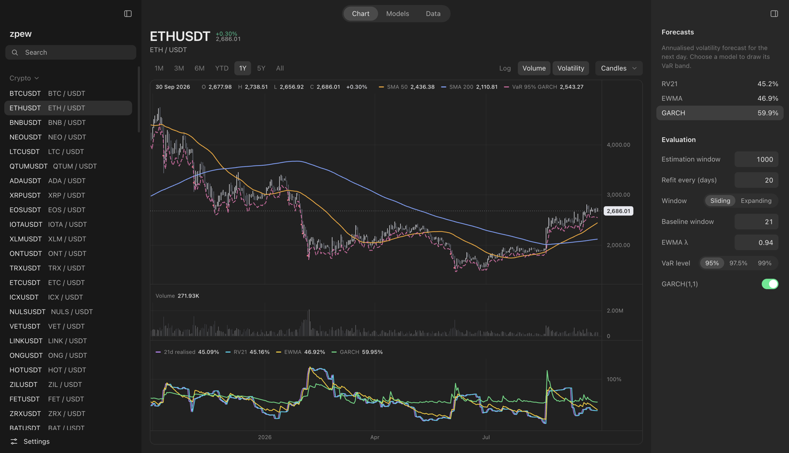
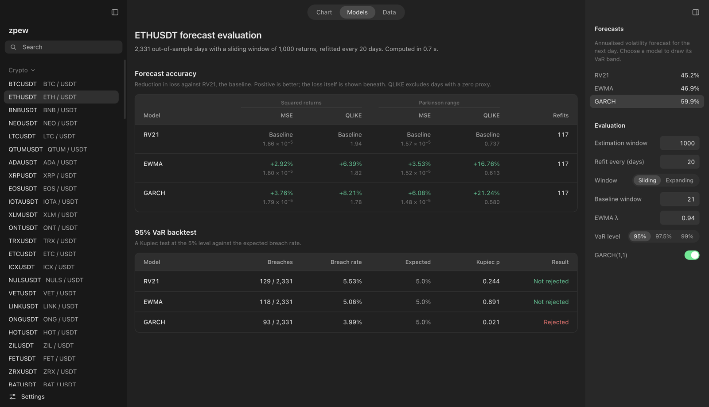
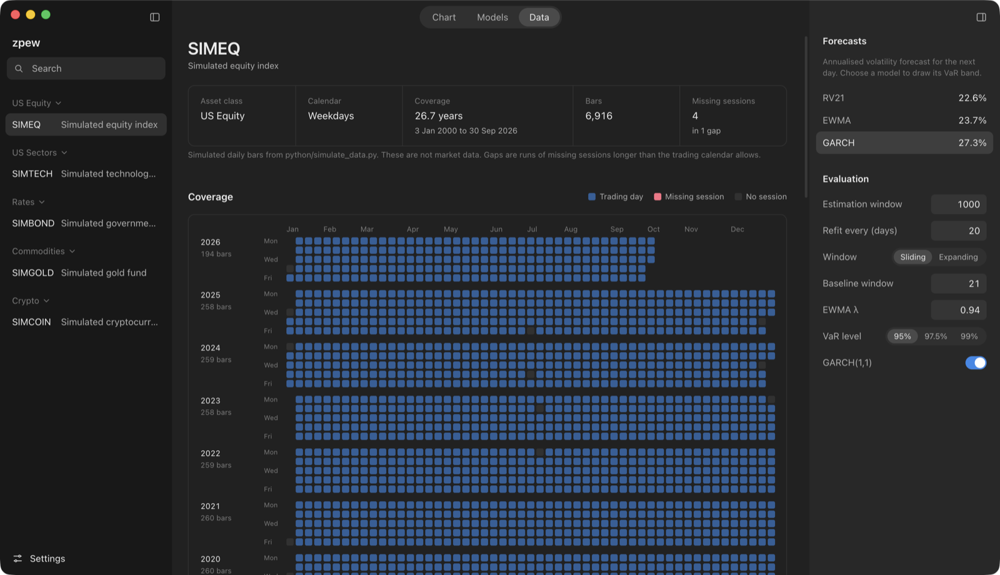

<div align="center">


# zpew

**Out-of-sample volatility forecasting and VaR backtesting, in C++20 with a native desktop app.**

[](https://github.com/mrailouis/zpew/actions/workflows/ci.yml)
[](LICENSE)
[](#building)
[](#building)
[](#desktop-app)

[Website](https://zpew.net) | [Methodology](#how-it-works) | [Building](#building) | [Data](#data)



<sub>All screenshots use simulated data from <code>python/simulate_data.py</code>, not market prices.</sub>

</div>

## What it is

zpew loads daily price history, forecasts volatility with three standard models, and tests those forecasts out of sample against what actually happened. It answers one question honestly: does a more complex volatility model beat a simple one once you stop letting it see the future?

It forecasts volatility, not prices, and it does not trade.

- **A C++20 core library** with the models, a Nelder-Mead optimiser, the rolling evaluation engine and the VaR backtest. No third-party numerical code.
- **A command-line tool** that runs the full evaluation from fixed data snapshots and writes every result with the commit, compiler, config hash and data hashes that produced it.
- **A desktop app** with its own Canvas chart engine, live forecast overlays and side-by-side model comparison.

**Results have not been published yet.** They will appear here and on [zpew.net](https://zpew.net) once the official runs are made from a clean commit.

## How it works

**Models.** Each forecast at day *t* uses only returns up to day *t*.

| Model | Description |
|---|---|
| Realised volatility (RV21, RV63) | The mean of the last 21 or 63 squared returns. RV21 is the baseline. |
| EWMA | RiskMetrics exponential smoothing with λ = 0.94. |
| GARCH(1,1) | Fitted by maximum likelihood with a Nelder-Mead search from a grid of starting points. Fits that end on the stationarity boundary are reported, not hidden. |

**Evaluation.** Models are refitted every 20 days on a window of 1,000 returns, in both a sliding and an expanding window. One-day-ahead forecasts are scored against two volatility proxies, squared returns and the Parkinson high-low range, with two loss functions, MSE and QLIKE. Each model's improvement over the baseline is pooled across assets as a mean, a median and a win count. These are the defaults in `configs/default.toml`.

**VaR backtest.** Each forecast becomes a one-day Value at Risk at 95% and 99%. Breaches are counted and tested against the expected rate with the Kupiec proportion-of-failures test.

**Checks.** A no-look-ahead test guards the rolling evaluation. EWMA forecasts are cross-checked against an independent Python implementation, and GARCH(1,1) fits against the [arch](https://github.com/bashtage/arch) library, on every asset.

## Desktop app

<table>
  <tr>
    <td width="50%"></td>
    <td width="50%"></td>
  </tr>
  <tr>
    <td><sub><b>Models.</b> Accuracy against the baseline under both proxies, and the VaR backtest.</sub></td>
    <td><sub><b>Data.</b> Snapshot details and a coverage grid with missing sessions highlighted.</sub></td>
  </tr>
</table>

- Candles, hollow candles, bars, line and area styles, with linear or log scale
- Moving averages, volume, realised volatility and every model's forecast on linked panes
- The VaR band and its breaches for any model, recomputed live as you change the evaluation settings
- Range presets, zoom, pan, crosshair readouts and keyboard navigation
- Light and dark themes, any accent colour, and native window chrome on macOS and Windows

The charts are written from scratch on the HTML Canvas. All analytics run in the C++ core through a Node native addon, off the main thread.

## Building

zpew needs CMake 3.25 or newer and a C++20 compiler. It is developed on macOS with Apple Clang and on Windows with Visual Studio 2022 or newer; Linux support is planned. CMake downloads the other dependencies (Catch2, nlohmann/json and toml++) at configure time, pinned by version and hash.

On macOS:

```
$ git clone https://github.com/mrailouis/zpew
$ cd zpew
$ cmake --preset macos-release
$ cmake --build --preset macos-release
$ ./build/macos-release/cli/zpew-cli --version
```

On Windows, from a Developer PowerShell for Visual Studio:

```
> cmake --preset windows-msvc
> cmake --build --preset windows-msvc-release
> .\build\windows-msvc\cli\Release\zpew-cli.exe --version
```

`CMakePresets.json` also has debug presets and AddressSanitizer presets (`macos-asan` and `windows-msvc-asan`).

### Desktop app

The app lives in `desktop/` and needs Node.js 24 (`desktop/.nvmrc` pins the exact version).

```
$ cd desktop
$ npm ci
$ npm start -- --manifest ../data/synthetic/manifest.json
```

`npm start` builds the native addon and the app, then opens it. Without `--manifest` the app looks for `data/manifest.json` from the working directory upwards. `npm run package` builds an installer for the current platform.

### Running tests

```
$ cmake --preset macos-debug
$ cmake --build --preset macos-debug
$ ctest --preset macos-debug
$ python3 -m unittest discover -s python
$ cd desktop && npm test
```

On Windows, use the `windows-msvc-debug` presets instead.

## Data

### Simulated data

The quickest way to try zpew is with simulated data. This writes five simulated assets, including a crypto-style asset that trades every day, to `data/synthetic/`:

```
$ python3 python/simulate_data.py
$ ./build/macos-release/cli/zpew-cli check-data --manifest data/synthetic/manifest.json
```

Returns follow a GARCH(1,1) process with fat-tailed shocks, so volatility clusters the way it does in real markets. The seed is fixed, so every run writes identical files.

### Market data

zpew runs on fixed local snapshots of daily USDT spot klines from [Binance Vision](https://data.binance.vision), Binance's public archive of historical market data. No snapshots are in this repository, because the terms do not allow hosting the raw data.

The study is crypto only. No source of daily equity, ETF, bond, commodity or currency prices could be found whose terms allow publishing results derived from it in a free, public project, so those asset classes are left out rather than shown with data that cannot be shared.

1. Fetch the snapshots. The script only needs Python 3.9 or newer and no API key:

   ```
   $ python3 python/fetch_binance.py --end 2026-09-30
   ```

   It lists every USDT spot pair Binance Vision has ever published, including delisted ones, and keeps pairs with at least 2,000 consecutive daily bars up to `--end`. Stablecoins, other pegged tokens and leveraged tokens are excluded. If a pair's history has a gap, only the bars after the last gap are kept, so returns never span missing days or a reused ticker. Every monthly archive is checked against Binance's published SHA-256 before use and cached under `data/snapshots/`. The decision for every candidate pair, included or excluded with the reason, is written to `data/universe.csv`.

2. Check that every snapshot loads and matches the manifest:

   ```
   $ ./build/macos-release/cli/zpew-cli check-data
   ```

`data/manifest.json` records the source, date range, row count and SHA-256 hash of every snapshot.

> [!IMPORTANT]
> Binance Vision data is licensed under [CC BY-NC-SA 4.0](https://creativecommons.org/licenses/by-nc-sa/4.0/) by the [Binance Vision Dataset Terms](https://data.binance.vision/Binance_Vision-Terms_of_Use.pdf). Use it only for non-commercial purposes. Results, figures and screenshots derived from it are credited to Binance Vision and shared under the same licence. zpew is not affiliated with or endorsed by Binance.

## Running the evaluation

```
$ ./build/macos-release/cli/zpew-cli eval --config configs/default.toml
$ ./build/macos-release/cli/zpew-cli backtest --config configs/default.toml
```

These write forecasts, losses, improvements over the baseline, backtest results and a `run.json` to `results/default/`. `run.json` records the git commit, compiler, config hash and the hash of every snapshot used. Both commands warn when the binary was built from uncommitted changes, because those results cannot be traced to a commit.

### Cross-checks

```
$ python3 python/crosscheck_ewma.py --cli build/macos-release/cli/zpew-cli
$ python3 -m venv .venv
$ .venv/bin/pip install -r python/requirements-crosscheck.txt
$ .venv/bin/python python/crosscheck.py --cli build/macos-release/cli/zpew-cli
```

The EWMA check uses only the standard library. The GARCH(1,1) check compares zpew's fits with the pinned [arch](https://github.com/bashtage/arch) library.

## Project layout

```
core/       zpew_core: data, returns, models, optimiser, evaluation, var, io
cli/        zpew-cli
desktop/    Electron app, React interface, Canvas charts and the native addon
tests/      Catch2 tests, mirroring core/
python/     data fetching, simulated data and cross-checks
configs/    evaluation configs
```

## License

zpew is licensed under the [Apache License 2.0](LICENSE).
